<p align="center">
  
</p>

<h1 align="center">Lantern</h1>

<p align="center">
  <a href="LICENSE"></a>
  
  
  <a href="https://github.com/misterekkk/lantern/actions/workflows/pages.yml"></a>
</p>

<p align="center">
  <a href="https://misterekkk.github.io/lantern/"><b>Try the interactive demo</b></a> · <a href="docs/ARCHITECTURE.md">Architecture</a> · <a href="docs/PRIVACY.md">Privacy</a>
</p>

Search your Mac **by meaning**, not just by file name: text, code, documents, photos, recordings and videos.
Lantern runs entirely on your Mac. It indexes your folders with Google DeepMind's open **EmbeddingGemma 2** model
(Apache 2.0) on Apple Silicon through MLX; after the one-time model download nothing leaves the machine (the opt-in
Spotify library sync is the only exception).

- *"decision tree pruning"* finds the README that explains it, even if it is written in Polish.
- *"def add_two(x, y):"* jumps to `script.py`, line 200, in your code editor.
- *"dog on the beach"* finds the photo; *"the cow on the farm"* finds the moment in a recording where it is said.

## See it in action

<p align="center">
  
</p>

<sub>Drawn, not recorded: the files, paths and texts are invented. `python3 scripts/showcase/build.py` makes it,
`scripts/showcase/video.sh` turns it into a 1080p video.</sub>

> **Status:** all planned phases are done (see [docs/ARCHITECTURE.md](docs/ARCHITECTURE.md)). Lantern is a working
> prototype tested on one Mac (M4, 16 GB). This README describes only what exists today.

## Features

- **A quick search panel** (⌥Space, or ⌘Space instead of Spotlight) with sections for applications, System
  Settings, code definitions, photos, files and music; the section that fits the query best comes first. One letter
  answers at once with the apps you use most (macOS's own launch counts), and a query you keep answering with the
  same result ("d" → Discord) puts it first. Coming from Alfred? Settings → Privacy imports the choices it learned.
- **Works with Raycast and Alfred:** keep your launcher and search with Lantern inside it ("Search Lantern" in
  Raycast with previews, thumbnails and filters; a workflow for Alfred). See [Use with Raycast or Alfred](#use-with-raycast-or-alfred).
- **Applications and System Settings**, like Spotlight: apps by any of their names (also translated and misspelt:
  `kalkul`, `dicsord`, `vsc`) or their App Store category (`muzyka` / `music` finds Spotify beside Music), panes and the ~560 single settings of macOS by their words (`24 godz`, `night shift`),
  and both by what they do as a fallback (`procent baterii`, `web browser`).
- **Apple Music** (off by default; Settings → Privacy): your library's songs and playlists by title, artist or album
  (`skeletons`, `travisa scotta`, `playlista`); ↩ plays a song or a playlist, ⌘↩ shows it in Music. Read through Apple's iTunesLibrary framework: names only, no audio, no lyrics
  (Apple keeps those on its servers).
- **Spotify** (off by default; Settings → Privacy): your playlists and liked songs, searched offline like Apple Music;
  ↩ plays in the Spotify app. Spotify keeps no readable list on the Mac, so this needs your own free key (an app at
  developer.spotify.com with the redirect URI `http://127.0.0.1:8000/callback`; Spotify requires Premium for it since
  2026) and a sign-in; Lantern then fetches only names, once a day and on "Sync Now". Songs of playlists made by
  others are not available from Spotify's API.
- **Instant answers on the Mac:** arithmetic (`2+2*20`, `15% * 200`), units (`2,5 km na mile`, `10 kg w funtach`,
  `100 f to c`) and the time in other cities (`godzina w nowym jorku`, `time in tokyo`); definitions from the
  dictionaries of macOS for a single word; your shortcuts (Shortcuts app); and a last row that opens the web search
  in your default browser (Google, DuckDuckGo, Bing or Ecosia, or off); it moves to the top when nothing on the Mac
  contains the query's words. That row only opens your browser; Lantern itself sends nothing.
- **Clipboard history** (off by default, Settings → Privacy): text you copied in the last 30 minutes or 8 hours,
  kept in memory only; ↩ copies it again.
- **Menu items and windows** (off by default, Settings → Privacy, needs the Accessibility permission): commands from
  the menus of the app in front ("new private window" in a browser) and open windows by their titles; ↩ runs the
  command or brings the window to the front.
- **The panel can be dragged** by its header; it snaps to the centre line of the screen and back to its default spot.
- **Hybrid ranking:** meaning (embeddings) and exact words (SQLite FTS5/BM25) fused with Reciprocal Rank Fusion.
- **Code:** split into functions and classes with tree-sitter (22 languages); a symbol table finds the exact line of
  a definition.
- **PDFs:** text page by page (Apple PDFKit); scanned pages are read with OCR. Results show the page.
- **Photos and video frames:** two models (EmbeddingGemma 2 vision tower and SigLIP 2) vote on what is in a picture,
  and macOS's own text recognition (Vision, on device) reads text in screenshots, scans and photos of documents.
- **Recordings and videos:** audio embeddings plus Whisper transcripts, with the moment each phrase is spoken.
- **Menu bar app** with a background daemon, an "ask before indexing" mode, pause on battery, in Low Power Mode, on heat
  and when memory runs short, an indexing schedule (any time, when idle, at night), a welcome window, and a settings
  window laid out like System Settings.
- **Private by design:** offline after a one-time model download (the opt-in Spotify sync is the only exception), read-only
  access to your files, no telemetry.

## Requirements

- **For the prebuilt app (`Lantern.dmg`):** a Mac with Apple Silicon (M1 or newer) and macOS 26.2 (Tahoe) or newer:
  the app is made for Liquid Glass, and MLX's libraries need macOS 26.2. Python 3.12,
  all packages and the `AVFoundation` media helper are inside `Lantern.app`; no Xcode, Homebrew, `uv` or `ffmpeg` is
  needed (`brew install ffmpeg` is optional if you index `.mkv` or `.webm` videos).
- **For building from source (`./install.sh`) and the `lantern` CLI:**

| What | Why | Install |
|---|---|---|
| Mac with Apple Silicon (tested: M4, 16 GB) | MLX runs on Apple Silicon only | – |
| Xcode Command Line Tools | compiler, git | `xcode-select --install` |
| Xcode 26 | builds the menu bar app (macOS 26 SDK) | App Store |
| Homebrew | package manager | https://brew.sh |
| uv | Python environment and dependencies | `brew install uv` |
| Python 3.12 | the daemon; **installed by uv**, not the system Python | automatic with `uv sync` |
| ffmpeg (optional) | MKV and WebM recordings only; everything else is decoded by macOS itself (AVFoundation) | `brew install ffmpeg` |

`uv sync` installs everything else into the project's `.venv` (nothing global, no PyTorch): MLX and a pinned `mlx-vlm`
commit (EmbeddingGemma 2 support), `transformers`, `tokenizers`, `sqlite-vec`, `tree-sitter-language-pack`,
`pathspec`, `charset-normalizer`, `mlx-whisper`, `pillow`, `soundfile`, `watchdog`, and `pyobjc-framework-Vision` /
`pyobjc-framework-Quartz` (Python bindings for macOS's text recognition and PDFKit; no models to download).

> The python.org Python (e.g. 3.13) does not work: it cannot load SQLite extensions, which `sqlite-vec` needs. The
> Python that uv installs can.

## Installation

### Via Homebrew (Recommended)

```bash
brew install --cask misterekkk/tap/lantern
```

### Download the app (`Lantern.dmg`)

1. Download **`Lantern.dmg`** from [Releases](https://github.com/misterekkk/lantern/releases) (or the latest artifact of
    the *Build Lantern.dmg* workflow in Actions), open it and drag **Lantern** to **Applications**.
2. Because the build is signed ad-hoc (without a paid Apple Developer ID), macOS Gatekeeper blocks the first launch of a
   downloaded copy. Allow it once:
   - either try to open **Lantern** in `/Applications`, then go to **System Settings → Privacy & Security** and click
     **Open Anyway** at the bottom (or right-click **Lantern.app** in Finder → **Open**),
   - or remove the quarantine attribute in Terminal:
     ```bash
     xattr -cr /Applications/Lantern.app
     ```
3. On first launch a **welcome window** walks through the setup, in the system's language: how often you will search
   (always ready, or when needed), which models to download (recommended for this Mac's memory: on an 8 GB Mac only
   the search model, ~1.3 GB; with 16 GB and more also Whisper for recordings and SigLIP 2 for photos), which folders
   to search, and whether to search from Lantern's panel, Raycast or Alfred. Closed early, it leaves one reminder
   notification; the menu bar icon shows a download arrow until the search model is there, and the menu offers the
   same download. Models can also be added later in **Settings → Performance**. Quick search (apps, System Settings,
   calculator, dictionary) works immediately while the model downloads.

### From source (`./install.sh`)

For the `lantern` command-line tool, manual page, and building from a checkout:

```bash
git clone https://github.com/misterekkk/lantern.git && cd lantern
./install.sh
```

The script checks the Mac (Apple Silicon, macOS 26.2+, Command Line Tools), installs `uv` and `ffmpeg` (for MKV/WebM) with Homebrew
(with Homebrew analytics off for its own calls; if Homebrew is missing it asks before running the official
installer), runs `uv sync`, downloads the required model and asks about the optional ones, checks that search works
offline, and builds the app into `/Applications` when Xcode 26 is present. It can be run again at any time: finished
steps are skipped. `./install.sh --all` installs everything without questions, `./install.sh --minimal` only the
command line and the required model; `--no-app`, `--test` (also run the tests). It never installs the LaunchAgent.

It also makes `lantern` and `man lantern` work in every terminal without sudo: two symlinks into this folder
(`~/.local/bin/lantern`, `~/.local/share/man/man1/lantern.1`, so `git pull` updates both), and, if you agree, one
`PATH` line in `~/.zprofile` between `# >>> lantern >>>` markers. `./install.sh --uninstall` removes the links, that
line and (if you say so) the app; your index and the models stay until you delete them (it prints how).

### Step by step

The same steps by hand:

```bash
# 1. System tools
xcode-select --install
# Homebrew: https://brew.sh. If `brew` is not on your PATH (Apple Silicon):
echo 'eval "$(/opt/homebrew/bin/brew shellenv)"' >> ~/.zprofile
eval "$(/opt/homebrew/bin/brew shellenv)"
brew install uv ffmpeg

# 2. Project and dependencies (uv downloads Python 3.12 into ~/.local/share/uv)
cd lantern
uv sync

# 3. One-time model download (needs internet; models go to ~/.cache/huggingface/hub/)
#    a) EmbeddingGemma 2, MLX 8-bit (~1.3 GB) — required
uv run hf download mlx-community/embeddinggemma-2-8bit --revision 7505ef2f8ddef45efef6d060865f27989b3c9cec
#    b) Whisper for transcripts (~1.6 GB) — skip if you do not index recordings or use --no-transcribe
uv run hf download mlx-community/whisper-large-v3-turbo --revision a4aaeec0636e6fef84abdcbe3544cb2bf7e9f6fb
#    c) SigLIP 2 for photo search (~1.5 GB + ~0.4 GB) — optional; without it EmbeddingGemma 2 ranks photos alone
uv run hf download google/siglip2-base-patch16-224 --revision 75de2d55ec2d0b4efc50b3e9ad70dba96a7b2fa2
uv run hf download mlx-community/siglip2-base-patch16-224-8bit --revision 5249fc157310584fe99dae6964707278eb6df50f

# 4. Check
uv run lantern --help
uv run pytest

# 5. Menu bar app
app/build.sh --install        # dev bundle (.venv), or app/build.sh --dmg for a self-contained Lantern.dmg
open /Applications/Lantern.app
```

Lantern always loads models with `HF_HUB_OFFLINE=1 TRANSFORMERS_OFFLINE=1 HF_HUB_DISABLE_TELEMETRY=1 DO_NOT_TRACK=1`;
an automated test checks that loading and embedding open no network connection.

**Building the app** needs Xcode 26 (the script selects it with `DEVELOPER_DIR`, without changing `xcode-select`).
It signs with your "Apple Development" certificate if you have one (Xcode → Settings → Accounts → Manage
Certificates); otherwise it signs ad hoc and macOS may ask for folder permissions again after every rebuild. `app/build.sh --dmg` bundles Python 3.12 and the daemon inside `Lantern.app` and creates `app/build/Lantern.dmg`.

## The app

- **Menu bar icon:** laid out like macOS's Battery menu: a status dot in the corner, macOS's own status images (green
  ready, amber indexing, setting up or waiting for your approval, grey paused, red not running or an index that needs
  attention; the word is in its tooltip), the file and fragment counts, a progress
  bar while indexing, pause / resume only while it applies, and "Lantern Settings…" at the bottom. A card with Index
  Now / Later appears when new files are found in "ask" mode. Folders are added in Settings → Folders; Quit Lantern
  is in Settings → About (or ⌘Q in a Lantern window).
- **⌥Space** opens the search panel (Settings → General: ⌘Space instead of Spotlight, or ⌃⌥Space). Results come
  in sections like in Spotlight: **Applications** and **System Settings** (↩ opens them), **Definitions**
  (functions and classes, with file, line and signature), **Photos** (with thumbnails) and **Files**. Recordings and
  videos show the moment of the match, e.g. `vlog.mp4 · 1:48`. The panel can be dragged by its top part; it snaps
  to the screen's centre line and its usual height, and its place is kept as a share of the screen, so it fits any
  display and comes back on screen when a monitor is unplugged.
  - Names that come from macOS (apps, settings, "Ustawienia systemowe") are shown in the system's language; Lantern's
    own words follow Lantern's language.
  - To use ⌘Space, macOS's Spotlight shortcut has to be turned off (System Settings → Keyboard → Keyboard
    Shortcuts… → Spotlight); Lantern says so and opens that page, but never changes system settings itself.
- **Filter icons** beside the query field, like Spotlight's mode buttons (round glass buttons; hover shows the name,
  choosing one puts it in the field with its ⌘ shortcut). Kinds: Applications, System Settings, Shortcuts, Clipboard,
  Code, Documents, PDFs, Photos, Recordings and videos, Music. They are folded into one filter button that unfolds
  when you point at it (once you type, up to three matching kinds show directly; a long query folds them again).
  ⌘1…⌘9 and ⌘0 pick one, Tab / ⇧Tab move between them, ⌫ in an empty field takes the chosen one out. Esc removes
  the filter first, then closes the panel; the panel opens empty.
- **Spelling:** after a short pause in typing, words that none of your languages knows get the spelling guesses of
  macOS (on the Mac), and Lantern searches again with the first guess its index knows (a word in your files, an app
  or a setting): "faktrua za prad" shows "Showing results for faktura za prad · Search for “faktrua za prad”
  instead". With no known guess the query stays as typed.
- **↩ on an answer** copies it; on a word definition it opens Dictionary; on a shortcut it runs it.
- **Learned choices:** a query you keep answering with the same result ("sl" → Slack) puts that result first from
  the second time on. ⌥↩ on an app opens a new window (browsers, Safari, Finder; other apps through their menu when
  menu items are on).
- **Inline completion:** while you type, the rest of a likely query appears in grey; → accepts it. Suggestions come
  from your earlier searches that led to an opened result, then from app and System Settings names, then function
  and file names in the index (never from the internet, never invented sentences).
- **Shortcut hints:** by default the selected result shows what ↩ and ⌘Y do with it (as Spotlight does); Settings →
  General → Shortcut hints switches to a bar at the bottom or hides them.
- **Shortcuts in the panel** (double-click = ↩, ⌥ + double-click = ⌥↩):

  | Key | Code and text | Recordings and videos |
  |---|---|---|
  | ↩ | open at the match (start of the passage) | QuickTime Player at the moment it is said |
  | ⌥↩ | open from the top | the whole recording from the start, in its default app |
  | ⌘Y | preview in the panel: the passage highlighted, with context | preview in the panel from the moment |
  | ⌘↩ | show in Finder | show in Finder |
  | ⌘C | copy the file (paste it in Finder or attach it); an app as a file, an answer as its value, a setting, song or shortcut as its name; with text selected in the field, that text | copy the file |
  | ⌥⌘C | copy the matched text: the whole passage (code: the chunk with the definition; a photo: the text read from it) | copy the transcript at the moment |
  | ↑↓ / Esc | select / close (from a preview: back to the list) | |
  | Tab / ⇧Tab, ⌘1…⌘0 | next / previous filter pill, pick a pill | |
  | → | accept the grey completion | |

  - PDFs open in their default app (Preview cannot be told to open a page); ⌘Y shows the matching page in Lantern
    with the passage highlighted.
  - Files open in the app macOS uses for their type, at the right line when that app supports it: VS Code
    (verified), Cursor, Xcode, JetBrains IDEs. Other apps (TextEdit, …) open the file at the top; the ⌘Y preview
    always shows the passage. Lantern never switches to an app other than your default.
  - The first time a recording opens, macOS asks "Lantern wants to control QuickTime Player". Without that
    permission ↩ shows the preview from the same moment. Formats macOS cannot play (mkv, webm) open from the start
    in their default app (VLC, IINA, …).
  - ⌘Y instead of Space: the panel's focus stays in the query field, where Space types a space. ⌘Y is the Quick
    Look shortcut of Finder.
- **Settings** (Settings… in the menu), laid out like System Settings:
  - **General:** open at login, language, search shortcut, preferred languages (the macOS ones plus any you add:
    used for app and setting names and for reading text in images), ask before indexing or index automatically,
    Restore Defaults (your folders stay),
  - **File Types:** photos and the text in them (OCR), places and people in photos, recordings and videos (with
    transcription and video frames), ignored extensions,
  - **Folders:** indexed folders, *Choose What to Index* (a folder tree with checkboxes, down to single files, with
    name search and the number of indexed files), exclusion patterns. Adding the whole disk, a system folder or
    `~/Library` is refused (iCloud Drive and cloud folders such as Dropbox are fine); a very large folder shows how
    many files it has and roughly how long the first indexing takes before it is added,
  - **Indexing:** pause indexing on battery power, in Low Power Mode or when the Mac is hot, and index any
    time, only when the Mac is idle (5 minutes without keyboard or mouse) or at night (hours of your choice); search
    works at any hour,
  - **Performance:** live memory chart of the daemon and the indexing process, peaks, current work and speed,
    models (revision, size on disk, where they are loaded),
  - **Privacy:** clear history, compact the index, data folder, Delete All Data (the index, history, settings,
    the Spotify sign-in and logs; never your files or the models), macOS permissions; **About**.
- **Language:** the app follows the macOS language (English and Polish today). To choose one for Lantern only:
  Settings → General → Language (Lantern restarts), or System Settings → General → Language & Region → Applications.
- **The app starts the daemon** as its child process, so macOS file permissions (Desktop, Documents, Downloads) are
  granted to Lantern with the usual "Lantern would like to access…" prompts. When the app quits or crashes, the
  daemon stops too. If a daemon from the LaunchAgent is already running, the app uses it.

## Use with Raycast or Alfred

Prefer Raycast or Alfred? Keep it and let Lantern do the searching. Lantern keeps running in the menu bar, indexing and
answering in the background, and that launcher shows Lantern's results: code definitions, files with the line, page
or moment, photos and video frames, recordings, your music and Shortcuts. Your choices there teach Lantern as in its
own panel.

### Raycast, step by step

The extension is in review for the Raycast Store; until it is published it is added once from this repository (needs
Node.js: `brew install node`). It does not install Lantern itself: without the app, "Search Lantern" shows the download
link and the Homebrew command, and while Lantern is setting up, downloading its models or indexing for the first time
it says so instead of showing no results. Raycast keeps its hotkeys to itself (no app can read or set them), so the
hotkey for "Search Lantern" is set in Raycast; Lantern's Settings say so instead of showing its own shortcut.

1. Install and open [Raycast](https://www.raycast.com), and have the Lantern app running.
2. Add the extension:

   ```bash
   cd integrations/raycast
   npm ci
   npm run dev        # adds "Search Lantern" to Raycast; when it says "ready", Ctrl+C (the command stays)
   ```

3. In Lantern: Settings → General → **Search from: Raycast**. Lantern's own shortcut turns off.
4. Choose how to open it, in Raycast's settings (sidebar → **Lantern** → Search Lantern):
   - **a hotkey**, e.g. ⌥Space. Raycast itself opens on ⌥Space by default: move Raycast's own hotkey first (sidebar →
     Raycast → Raycast Hotkey), for example to ⌘Space instead of Spotlight;
   - **an alias**, e.g. `l`: type `l`, a space and your query in Raycast;
   - **a fallback**: Raycast's settings → Fallback Commands → add "Search Lantern". It then appears under every query
     in Raycast, and ↩ on it shows Lantern's results for what you typed.

Keys in "Search Lantern":

| Key | Action |
|---|---|
| ↩ | open at the line (VS Code, VSCodium, Cursor, Xcode, JetBrains), play from the moment (QuickTime), a PDF at its page (Skim; Preview through its Go to Page shortcut, which needs the Accessibility permission for Raycast), play a song |
| ⌥↩ | open from the start (a recording from 0:00) |
| ⌘↩ | show in Finder (a song: in Music or Spotify) |
| ⌘Y | preview, as in the panel: the code around the line or the whole passage with your words in bold, inside Raycast; a photo in Quick Look (the whole photo); a video or recording in Lantern's own player, the same as the panel's: the whole file, started at the moment of the match, scrubbable back to the start (Raycast asks the Lantern app through `lantern://preview`); ⌘Y again closes it |
| ⇧⌘Y | text and code: Quick Look of the whole file; a video or recording: its frame and transcript at the moment, inside Raycast |
| ⌃1 … ⌃0 | filter by kind, the panel's digits (Raycast keeps ⌘1 … ⌘9 for opening the Nth result); the same again for all kinds |

The pane beside the results shows the code around a result (its lines marked ▶), the passage with your words in bold
and thumbnails of photos and video frames. Raycast never reads your folders, so it asks for no access to them: the
text comes from Lantern, and the thumbnails are made by Lantern into its cache, deleted after 10 minutes (see
[PRIVACY.md](docs/PRIVACY.md)). Details: [integrations/raycast](integrations/raycast).

### Alfred

Alfred runs workflows with its paid Powerpack. In Lantern: Settings → General → **Search from: Alfred** → *Install
the Alfred Workflow…*; then type `l` and your query in Alfred, or give the workflow a hotkey. ↩ opens at the line or
moment, ⌥↩ from the start, ⌘↩ shows in Finder, ⇧ Quick Look. The workflow is not tested inside Alfred yet: feedback
welcome. Details: [integrations/alfred](integrations/alfred).

Searches go to Lantern over its local socket and never leave the Mac; what the launcher itself does is up to it
(Raycast and Alfred have their own privacy policies).

## Command line

Full reference with every option, output format, environment variable, exit code and the socket API:
[docs/CLI.md](docs/CLI.md), or `man lantern` after `./install.sh`. The examples use `uv run lantern` (works from the
repository folder); after `./install.sh`, plain `lantern` works everywhere.

```bash
uv run lantern index ~/Projects            # first run: scan + index; later runs: only changes
uv run lantern search "decision tree pruning"
uv run lantern search "def add_two(x, y):" -n 5
uv run lantern open 1                      # open result 1 of the last search (--reveal: Finder, --print: path:line)
uv run lantern status
uv run lantern remove ~/Projects           # remove a folder and all its data from the index
uv run lantern compact                     # physically erase deleted data from the index file
uv run lantern clear-history               # delete the local search history
uv run lantern search "zdjęcia z Krakowa" --json   # the whole reply as JSON (also status, pending, config, models)
uv run lantern models                      # models: size, downloaded, recommended for this Mac; `models download`
uv run lantern languages add de            # extra languages for app names and text in images
uv run lantern rebuild --yes               # start the index again, keeping the folders
uv run lantern config schedule night       # index only at night (or idle / anytime); search works at any hour
uv run lantern restore-defaults --yes      # every setting back to its default; folders stay
uv run lantern delete-all-data --yes       # the index, history, settings and logs; never your files or models
uv run lantern diagnostics                 # a report for a bug report, without file names
```

- The CLI has the same settings and actions as the app (folders, every setting through `lantern config`, models,
  languages, rebuilding the index, restoring the defaults, deleting all data); only the menu bar app's own features (the search panel, Raycast / Alfred, the
  clipboard, menu items and windows, Apple Music) have no command.

- `index` compares the folder with the index: new and changed files are indexed, moved files are recognised by
  content (no recomputation), deleted files are removed together with their text and vectors.
- The whole disk, system folders and `~/Library` (apart from iCloud Drive and cloud folders) are refused; a new folder
  with 20 000 files or 50 GB and more prints its estimate and needs `--yes`, as the app asks before adding it.
- If a folder is unavailable (unplugged disk, network share), nothing is removed. If more than half of a folder's
  files vanished, `index` refuses without `--force`. Files you excluded on purpose (still on the disk) are removed
  without it.
- Every search and opened result is kept in a **local** history (query and result positions, no file content), as
  training data for a future ranking model. `--no-log` skips it, `clear-history` deletes it.
- Changing the chunking rules or the model re-indexes the affected files automatically.

## How search works

- **Two lists, one ranking:** meaning (EmbeddingGemma 2: paraphrases, other languages) and exact words (FTS5/BM25:
  function names, error messages), fused with Reciprocal Rank Fusion. Each result shows where it came from, e.g.
  `(meaning #1 · keywords #3)`. Keyword search skips stop words and matches Polish inflections by stem.
  Letters match without their accents and strokes in any language: `lodz` finds `Łódź`, `soren` finds `Søren`,
  `strasse` finds `Straße`.
- **One folder only:** `in:` and a folder name keeps results to files under folders whose name starts with it, in the
  panel, Raycast, Alfred and the CLI: `in:down umowa najmu`, `in:Studia`, `in:"Moje dokumenty" faktura`, or a path,
  `in:~/Projects/lantern readme`. The folder word is never spell-checked or sent to the model; apps, settings and
  answers are left out, since they are not in a folder.
- **When and where** (Polish and English): a time in the query keeps results to files made then.
  - Examples: `zdjęcia z maja 2023`, `umowa z 2024`, `faktura wczoraj`, `photos from last summer`,
    `dokumenty w zeszłym tygodniu`, `14.05.2023`.
  - A bare year or month (`wakacje 2023`, `sierpień`) only moves files made then higher; nothing is hidden, since the
    word may as well be in a document's text.
  - A time or a place alone, or with `zdjęcia`, `filmy`, `dokumenty`, lists what was made then or there, newest first.
  - Where a date comes from: a photo's EXIF data, a video's or recording's own creation date, a date in the file or
    folder name (`IMG_20230514_…`, `2023-05-14 Wakacje/`), and otherwise the file's dates on the disk. So for most
    documents "from 2024" means *created or last changed in 2024*, not *mentions 2024*. Impossible dates (before 1990,
    in the future, a camera's reset clock such as 2000-01-01 00:00) and numbers that only look like years are ignored.
- **Places** (any language): `zdjęcia z Krakowa`, `photos in Kraków`, `Bilder aus Krakau`, `zdjęcia z Portugalii`.
  - The city comes from the location saved in photos and videos, matched to the nearest city of 15,000+ people in a
    table built into Lantern (GeoNames). Nothing is looked up online.
  - A camera without GPS: a photo in a folder named after a country (`Portugalia/`, `Wakacje w Portugalii 2026/`) gets
    that country. Screenshots and graphics never do.
  - Photos and recordings show the date and the city in their row.
  - Switch: Settings → File Types → Places in photos and videos, or `lantern config places false`; switching it off
    deletes the saved locations from the index.
- **People in photos** (Polish and English): `zdjęcia kobiet`, `mężczyzna w Krakowie`,
  `zdjęcie kobiety z 2024 w Portugalii`, `z ludźmi`, `bez ludzi`, `grupa` (three or more people), `selfie` / `portret`,
  `dwie osoby`, `kobieta i mężczyzna`.
  - These words narrow the photos section only; documents containing them are found as before.
  - macOS (Vision, on this Mac) counts the people; the photo model guesses woman or man from appearance on a crop
    around each of the four largest. Only the numbers are stored.
  - Measured on a public test set: people found in 97% of photos with people and never in a photo without; the exact
    count in 80% (groups are undercounted); woman/man right in 98% of one-person photos (docs/DECISIONS.md).
  - Switch: Settings → File Types → People in photos, or `lantern config people false`, which deletes the counts.
- **After an update from 0.1.x** nothing is indexed again: dates and places are read from file headers in a minute or
  two, people are counted in the background (about a quarter of a second per photo; files waiting for your approval
  stay waiting). `lantern status` shows what is left.
- **Indexed types:** code (Python, JS/TS, Go, Rust, Java, Kotlin, Swift, C/C++, C#, Ruby, PHP and more, split into
  functions and classes), text (Markdown, txt, JSON, YAML, HTML…; text files over 2 MB and binaries are skipped),
  PDFs, audio (mp3, m4a, wav, flac, ogg, opus, aac, aiff…), video (mp4, mov, mkv, webm, avi…: sound and frames) and
  photos (jpg, png, heic, gif, webp, tiff, bmp).

### PDFs and text in images

- **PDFs** are read page by page with Apple PDFKit; each result shows its page (`report.pdf (page 12)`). Pages without
  a text layer (scans) are read with OCR. Password-protected PDFs are skipped; very large ones are capped (1000 pages,
  100 scanned pages).
- **Text in images** is read by macOS itself (the Vision framework behind Live Text: on device, Polish and English,
  no model to download, ~110 MB while running) in a cascade: screenshots and scans by name go straight to reading;
  every other image first passes a fast check (~10 ms) for at least two real words, so ordinary photos cost almost
  nothing; low-confidence lines, symbol garbage and camera watermarks are dropped.
- The text becomes searchable by exact words (`0x80070002`, a VIN, an invoice number, `245,30 zł`) and by meaning;
  the photo appears in the Photos section with the matching text under it ("text in image"). Numbers and codes with
  separators (`187,15`, `FV/2025/09/0932`) must match as a whole, not as loose parts.
- The photo models alone already find images with text by meaning ("faktura za prąd", "błąd aktualizacji
  windows"); OCR adds exact strings and small print. Measured: DECISIONS.md, "OCR research" and Phase 11.
- Off switch: Settings → File Types → Text in photos and screenshots, or `lantern config index_image_text false`.

### Code definitions

- Paste a line of code or just a name: `def add_two(x, y):`, `add_two`, `addTwo`, `class Client`, `Client::connect`,
  `BinMapper.transform`, `public void testReplaceIndex()`. The result is the file, the **exact line** and the
  signature, e.g. `script.py:200   def add_two(x, y)`.
- Names match regardless of style (`add_two` = `addTwo` = `AddTwo`): exactly first, then by prefix (`add_two` →
  `add_two_numbers`) and by fragment (`UserToken` → `parseUserToken`). The number of arguments, the kind (`def`,
  `class`…) and the parent class help pick the right definition. Sentences ("tree pruning") never list definitions.
- Languages: Python, JavaScript, TypeScript, Go, Rust, Java, Kotlin, Swift, C, C++, Objective-C, C#, Scala, Ruby,
  PHP, Lua, R, Dart, Elixir, Haskell, SQL, Bash (each covered by a test). Only definitions are searched, not calls.

### Photos and video frames

- Find a photo by **what is in it** ("dog", "bicycle", "child in the water", "sunset"), in English or Polish, or by
  its file name.
- Two models rate every photo: the EmbeddingGemma 2 vision tower (better at sentences and Polish) and SigLIP 2 base
  (better at single words). Their scores are normalised and summed; a photo is listed only when it clearly stands
  out from the rest.
- Videos: frames at scene changes (macOS's AVFoundation; ffmpeg for MKV/WebM), at least one every 30 s, near-duplicates dropped before embedding. A
  video is found by what is seen in it even when nobody speaks ("sea", "beach"), at the moment it is seen; text on
  its frames (slides, screen recordings, captions) is read like text in photos and found at its moment too.
- Skipped: images under 96 px (icons), over 100 MB, or broken. HEIC is decoded with the system's `sips`.
- Speed (M4): ~3 photos/s including model loading, i.e. ~1 hour for 10,000 photos in the background.

### Recordings and videos

- macOS (AVFoundation, through Lantern's `lantern-media` helper) streams the audio (16 kHz mono) window by window, so
  the length of a recording does not affect memory. MKV and WebM, which macOS cannot read, go through ffmpeg if it is
  installed; measured equal for search (docs/DECISIONS.md, "Phase 14").
- Two tracks in one ranking: **audio embeddings** of 30 s windows with 5 s overlap (the meaning of what is said,
  also across languages) and **Whisper large-v3-turbo transcripts** in ~20 s chunks (single words, text previews).
- `lantern index <folder> --no-transcribe` skips Whisper (faster, but single words are not found).

## Folders and exclusions

- Add folders in Settings → Folders (Add Folder…, with a tree to choose what to skip) or with `lantern index <folder>`. You can add your whole home folder:
  `lantern index ~ --dry-run` first counts files and estimates the time without reading or writing anything.
- **Home folder rules** (always on): `~/Library` is skipped (mail, caches, app data) except **iCloud Drive**;
  `~/Applications`, the Apple Music library and all macOS packages (`*.app`, `*.photoslibrary`, iWork documents,
  disk images…) are skipped; hidden folders and files are skipped except `.github`.
- **iCloud:** files that exist only in the cloud are skipped (reading them would download them) and indexed once they
  are on the disk. A file already indexed that iCloud evicts stays in the index.
- **Permissions:** Desktop, Documents, Downloads and iCloud Drive need macOS permission. A folder without access is
  skipped and its previously indexed files are **kept**; `lantern status` shows a warning.
- **Always excluded:** `.git`, `node_modules`, `vendor`, virtual environments, build and cache folders (`target`,
  `dist`, `DerivedData`, `Pods`…); files with secrets (`.env*`, `*.pem`, `*.key`, `*.p12`, SSH keys `id_*`, `.netrc`,
  credential, service-account and token files, `*.tfstate`…); lockfiles; everything in `.gitignore` files, including
  those above the indexed folder in the same repository (indexing `repo/src` honours `repo/.gitignore`); symbolic
  links (Lantern never leaves the folder you chose).
- **Unreadable or broken files** (no permission, a recording cut off mid-write, a text file over 2 MB) are skipped
  with a reason in `lantern status`; the rest of the folder is indexed as usual.
- **Choose what to index:** in Settings → Folders → Choose What to Index, unchecking a file or folder excludes it;
  checking an item inside an excluded folder brings back only that item.
- **Ignored extensions** (default: `.ipynb`, `.csv`, `.tsv` — notebooks and tables are mostly output and numbers):

  ```bash
  uv run lantern ignore list
  uv run lantern ignore add json log        # csv, .csv and *.csv mean the same
  uv run lantern ignore remove csv
  ```

- **Exclusion patterns and paths:**

  ```bash
  uv run lantern exclude add ~/Downloads/some-library   # a folder or file
  uv run lantern exclude add "*.log"                    # a .gitignore-style pattern, in every folder
  uv run lantern exclude list | remove <pattern>
  ```

- **File types:** `lantern config index_photos false`, `index_audio_video false`, `index_video_frames false`
  (also in Settings → File Types). Excluded files disappear from the index at the next scan.
- **Transcription on and off:** Settings → File Types → *Transcribe speech (Whisper)*, or
  `lantern config transcribe false` / `true`. The switch is off and greyed out until Whisper is downloaded
  (Settings → Performance). With it off:
  - new recordings and videos are indexed by their sound only (audio embeddings find what is talked about, not
    single words or names), plus video frames;
  - transcripts made earlier stay in the index and stay searchable; transcripts still waiting in the queue wait;
  - switched on again, every recording without a transcript is queued for one automatically.

  To delete transcripts made earlier, remove the folder (`lantern remove <folder>`) and add it again with
  transcription off. For one run without the daemon, `lantern index <folder> --no-transcribe` skips Whisper.

## Background daemon

```bash
uv run lantern daemon install     # install and start the LaunchAgent (starts at login)
uv run lantern daemon run         # or run the daemon in the foreground (Ctrl+C stops it)
uv run lantern pending            # files found by the daemon, waiting for approval
uv run lantern approve | decline  # index them / ask again on the next change
uv run lantern pause | resume
uv run lantern config index_mode auto   # index right away instead of asking (default: ask)
uv run lantern daemon stop | uninstall
```

- **On start** (also after a long shutdown) the daemon scans all folders: deleted files leave the index at once; new
  and changed ones wait for approval in "ask" mode. While running, FSEvents report changes.
- **Indexing runs in a separate background-priority process**: the audio, vision and Whisper models live only there
  and are released when it finishes. The idle daemon uses ~490 MB. Searches run at a higher priority than the
  daemon's own scans, so they stay fast while it works (measured in DECISIONS.md, "Power and QoS").
- **Automatic pause** on battery power, in Low Power Mode and when macOS reports the Mac is hot (thermal state
  "serious" or worse), and when less than 2 GB is free on the disk of the index; the current file is finished, the
  rest waits. `lantern status` shows what the daemon sees.
- **Memory:** a busy Mac often sits at macOS's "warn" memory level for hours (it compresses idle memory); then only
  heavy work waits (Whisper, video frames) and ordinary indexing goes on. When the Mac really runs short (critical
  pressure, or warn with swap growing fast) the worker finishes its file and indexing waits until the Mac has been calm
  for 3 minutes; at critical pressure it stops at once and the photo query model is released. Whisper (~1.8 GB) starts only while the Mac has room for it at that moment, whatever its total memory, so
  a Mac busy with something heavy (training a model, a game) is left alone. The menu says why indexing waits. The
  models' memory limit follows the free memory, at most 1 GB on an 8 GB Mac (measurements in docs/DECISIONS.md).
- **Always ready or when needed** (Settings → Performance → Search model, `lantern config mode ready|on_demand|battery`;
  the welcome window asks): when needed, the search model (~0.5 GB) is released after 10 minutes without a search and
  loaded again by the next one in about half a second (apps and settings answer without it); "when needed on battery"
  keeps it ready on the charger and releases it only on battery. An 8 GB Mac starts in this mode, with Whisper and video frames off.
- **An index Lantern cannot use** (from a newer Lantern after going back to an older one, or a damaged file) is
  explained in the menu with what to do: get the latest version, or rebuild the index (your folders stay, everything
  is indexed again; your files are never touched). The daemon checks the index in the background after starting.
- **A stuck file never stops the queue:** a file the worker spends more than 30 minutes on (90 for a transcript;
  e.g. a hung PDF or image decoder) is skipped with the reason in `lantern status` and the warnings, and indexing
  goes on with the next one.
- **Settings** live in `~/Library/Application Support/Lantern/config.toml` (`lantern config` lists them).
- **API:** Unix socket `~/Library/Application Support/Lantern/lantern.sock` (mode `0600`, folder `0700`), JSON lines.
  The menu bar app uses the same API.
- **Logs:** `~/Library/Application Support/Lantern/logs/` (paths and errors, never file contents or queries).

## Privacy

- Everything runs **locally and offline** after the one-time model download. No telemetry, no external APIs, with one
  opt-in exception you switch on yourself: the Spotify library sync (see below and [PRIVACY.md](docs/PRIVACY.md)).
- Lantern **only reads** the files it indexes. It never modifies, moves or deletes them.
- The index is one SQLite file in `~/Library/Application Support/Lantern/` (not synced with iCloud). It contains text
  passages, code signatures and vectors derived from your files: treat it like a copy of them. Exclude it from
  Time Machine if you like:

  ```bash
  tmutil addexclusion "$HOME/Library/Application Support/Lantern"
  ```

- Deleted means deleted: text, keyword index rows and vectors are removed in one transaction, with SQLite
  `secure_delete`, FTS5 `secure-delete` and `VACUUM` (`lantern compact`, automatic after large removals). A test
  checks that removed text is gone from the raw bytes of the database file.
- **Company code:** nothing leaves the Mac, but check with your IT/security team before indexing company
  repositories. Keep FileVault on and the default secret exclusions in place.
- Details: [docs/PRIVACY.md](docs/PRIVACY.md).

## Known limitations

- The MLX backend uses an **unreleased `mlx-vlm` branch** (pinned commit) and community-converted `mlx-community`
  weights. Vectors match the original model (cosine 0.9998), but this dependency needs watching.
- Memory (measured on M4): idle daemon ~490 MB, plus ~340 MB for the photo query model while the panel is in use
  (released after 5 minutes); the indexing process up to ~2 GB for text, ~3.3 GB for recordings and ~4 GB for photos,
  then it exits.
- Photo search was measured on 1,000 Flickr30k photos and an 80-photo test folder; real libraries (many similar
  photos, blurred or strongly skewed phone shots of documents) may behave differently.
- Audio search was evaluated on synthetic speech; real recordings (noise, several speakers) may do worse.
  Transcripts cover the first 4 hours of a recording; audio embeddings cover all of it.
- Large files (> 64 MB, mostly videos) are recognised by size and content samples, not a full hash.
- CSV/TSV and large number-heavy files are indexed by their head only (when not ignored).
- Polish inflection in keyword search is approximated by stem prefixes, not a real stemmer.
- Full list of open questions: [docs/DECISIONS.md](docs/DECISIONS.md#open-questions).

## Acknowledgements & Prior Art

- [DigUp](https://github.com/ARahim3/DigUp) by [@ARahim3](https://github.com/ARahim3) — for demonstrating the power of on-device multimodal search with EmbeddingGemma 2, which initially inspired this project.
- Google DeepMind for [EmbeddingGemma 2](https://huggingface.co/google/embeddinggemma-2).
- Apple MLX team for [mlx](https://github.com/ml-explore/mlx) and [mlx-vlm](https://github.com/ml-explore/mlx-vlm).

## License

Lantern is licensed under the [Apache License 2.0](LICENSE). The model weights are not part of this repository; you
download them yourself, and each has its own license (see [NOTICE](NOTICE)): EmbeddingGemma 2 and SigLIP 2 are
Apache 2.0, Whisper is MIT.

Apple, macOS and Spotlight are trademarks of Apple Inc. Lantern is an independent project, not affiliated with
or endorsed by Apple.

## Development

```bash
uv run pytest            # fast tests (no real model)
uv run pytest -m model   # tests with the real models (downloaded): reference vectors, no network access, search
uv run ruff check
DEVELOPER_DIR=/Applications/Xcode.app/Contents/Developer swift test --package-path app
```

The website in `site/` needs Node.js (`brew install node`); see [site/README.md](site/README.md).

Optional, for coding agents: a local code graph with [graphify](https://github.com/Graphify-Labs/graphify)
(`uv tool install graphifyy==0.9.76`, then `GRAPHIFY_BACKEND=none graphify update .`: code only, parsed locally,
nothing sent anywhere). Its output (`graphify-out/`) and personal agent files (`CLAUDE.local.md`,
`.claude/settings.local.json`) are gitignored.

```
README.md, LICENSE, NOTICE, CLAUDE.md, pyproject.toml
site/        the website: landing page, docs built from this README and docs/, the interactive demo
docs/        ARCHITECTURE.md, DECISIONS.md (decisions, measurements, open questions), PRIVACY.md
daemon/      the daemon (Python package `lantern`): api, scanner, queue, extractors, chunking, embedding, store,
             search, service, cli.py
app/         the menu bar app (Swift package: LanternCore + Lantern, build.sh)
launchd/     LaunchAgent template
spikes/      measurement scripts behind the decisions (not part of the app)
tests/       pytest suite
```

`CLAUDE.md`, `daemon/CLAUDE.md` and `app/CLAUDE.md` describe the conventions for contributors (and coding agents).
